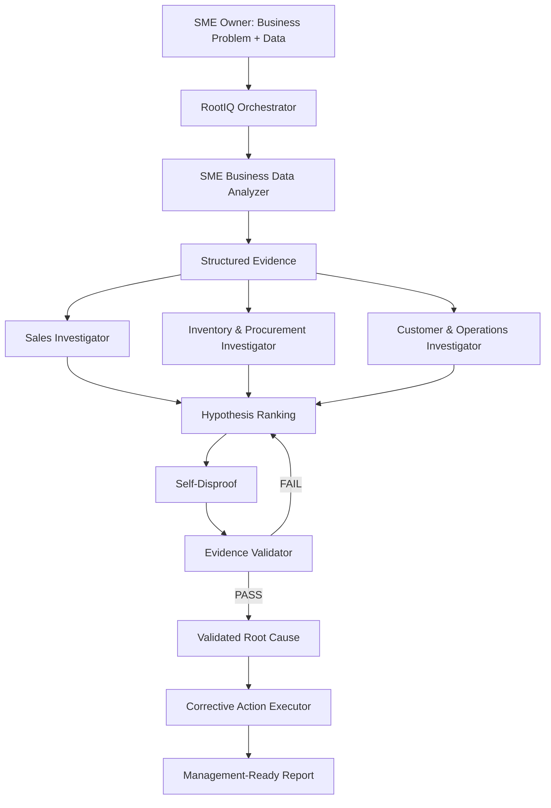

# RootIQ Architecture

## Overview

RootIQ is an autonomous root-cause investigation system for small and medium enterprises (SMEs). Given a business problem ("Why did revenue drop?") and an Excel/CSV dataset, RootIQ executes a 14-step workflow that performs deterministic data analysis, generates and ranks competing hypotheses, challenges its own leading hypothesis through self-disproof, validates the conclusion through an independent evidence validator, and produces a management-ready report with a SMART corrective action register.

The system is built on the WorkBuddy AI platform, combining WorkBuddy Skills (deterministic analysis, corrective actions), WorkBuddy Experts (specialist investigators), and a custom Teammate2 reasoning engine (hypothesis ranking, causal chain construction, evidence validation). A custom orchestrator coordinates all components into a single end-to-end pipeline.

---

## Main Components

### 1. RootIQ Orchestrator

- **Role:** Coordinates the 14-step end-to-end workflow. Receives the business problem and evidence package, routes evidence to specialists, runs the Teammate2 engine, executes self-disproof, quantifies financial impact, generates corrective actions, and produces all output artifacts.
- **Input:** A handoff JSON file (containing verified analysis results, evidence, and investigator hypotheses) plus a business problem statement.
- **Output:** 7 artifacts -- final report (Markdown), case result (JSON), validation report (JSON), action register (CSV), investigation trace (JSON), Teammate2 payload (JSON), Teammate2 raw result (JSON).
- **What it must NOT do:** Perform data analysis itself (delegated to the Data Analyzer), invent metrics, fabricate evidence, or skip the self-disproof and validation stages.

**Implementation:** `rootiq_orchestrator.py` (~30KB, Python, dependency-free)

### 2. SME Business Data Analyzer Skill

- **Role:** Deterministic, LLM-free data analysis engine. Reads Excel/CSV workbooks, validates schema, parses dates and numerics, tags records into baseline/current periods, computes 28+ metrics across 6 business areas (Sales, Inventory, Procurement, Suppliers, Customers, Operations), detects anomalies via 19 configurable rules, ranks anomalies by composite score, and outputs structured JSON + CSV evidence.
- **Input:** An Excel workbook (`.xlsx`) or CSV files containing SME business data (Sales, Inventory, Purchase_Orders, Suppliers, Customer_Feedback, Operations).
- **Output:** `analysis_summary.json` (structured metrics, anomalies, data quality report) + `analysis_summary.csv` (flat metrics table).
- **What it must NOT do:** Perform root-cause reasoning, provide business recommendations, estimate missing values, or use any LLM/AI for calculations.

**Implementation:** WorkBuddy Skill (`sme-business-data-analyzer`), `scripts/sme_analyzer.py` (1,599 lines, pandas)

### 3. Sales Performance Investigator

- **Role:** Sales-domain specialist. Receives sales evidence and product metrics, investigates revenue/units/price changes at the product level, generates competing sales-related hypotheses with supporting, contradicting, and missing evidence, and assigns confidence levels.
- **Input:** Product findings, overall sales metrics, ranked anomalies (from the Data Analyzer output).
- **Output:** Primary sales finding, scope classification (product-specific vs. company-wide), ranked hypotheses with evidence assessments, recommended next investigation domain.
- **What it must NOT do:** Investigate inventory, procurement, supplier, or operations causes; provide management recommendations; claim final root cause.

**Implementation:** WorkBuddy Expert (`sales-performance-investigator`), 7-step investigation protocol

### 4. Inventory & Procurement Investigator

- **Role:** Supply-side specialist (Teammate2 Role 2A). Investigates inventory health, stockouts, purchase-order approval timing, supplier lead times, and procurement fulfilment. Generates supply-side hypotheses and contributes to the causal chain.
- **Input:** Inventory evidence, procurement evidence, ranked anomalies (mapped to Teammate2 format via the RootIQ Mapper).
- **Output:** Supply-side findings, contributing factors for the causal chain.
- **What it must NOT do:** Investigate customer, operations, or sales causes; override the ranking engine; claim final root cause independently.

**Implementation:** Teammate2 engine (`rootiq.py` v2.0.0), Role 2A

### 5. Customer & Operations Investigator

- **Role:** Demand-side specialist (Teammate2 Role 2B). Investigates complaint rates, complaint types, delivery delays, fulfilment times, staffing levels, capacity utilization, and shift-level breakdowns. Generates demand-side and operations hypotheses.
- **Input:** Customer evidence, operations evidence (including shift-level breakdowns), ranked anomalies.
- **Output:** Demand-side findings, operations findings, contributing factors for the causal chain.
- **What it must NOT do:** Investigate supply-side causes (inventory, procurement, suppliers); override the ranking engine; claim final root cause independently.

**Implementation:** Teammate2 engine (`rootiq.py` v2.0.0), Role 2B

### 6. Multi-angle Hypothesis Ranking / Self-Disproof Component

- **Role:** Two-part component. **Hypothesis Ranking** (Teammate2 Role 2C) collects all hypotheses from specialist investigators, ranks them by a composite priority score (magnitude x relevance x weight), and proposes the leading hypothesis as the provisional root cause. **Self-Disproof** (orchestrator module) challenges the leading hypothesis across 5 dimensions: control groups, timing alignment, alternative explanations, missing evidence, and causal link strength.
- **Input:** All specialist hypotheses, structured evidence (comparisons, timelines, mechanisms, impacts), metric payload.
- **Output:** Ranked hypothesis list with priority scores, dispositions (SUPPORTED_SIGNAL / UNRESOLVED), proposed root cause (PROVISIONAL), self-disproof verdict (PASS / PASS WITH CAUTION / FAIL), 5-dimension challenge results.
- **What it must NOT do:** Declare certainty without evidence; skip the self-disproof challenge; rank hypotheses without evidence; treat signal confidence as causal proof.

**Implementation:** Teammate2 Role 2C (`rootiq.py`) + orchestrator self-disproof module

### 7. Evidence Validator

- **Role:** Independent validation stage (Teammate2 Role 2D). Runs 8 checks against the proposed root cause: Data Support, Chronology, Causality vs. Symptom, Alternative Explanations, Contradiction Check, Chain Validation, Math Verification, and AI Fabrication Check. Can return PASS, PASS WITH CAUTION, or FAIL.
- **Input:** Proposed root cause, causal chain, all evidence, hypothesis ranking results.
- **Output:** Validation status (PASS / PASS WITH CAUTION / FAIL), per-check results, supported/questionable/missing claim counts, required corrections.
- **What it must NOT do:** Automatically approve every conclusion; skip checks; downgrade a FAIL to PASS; fabricate validation evidence.

**Implementation:** Teammate2 engine (`rootiq.py` v2.0.0), Role 2D

### 8. Corrective Action Executor

- **Role:** Generates SMART (Specific, Measurable, Achievable, Relevant, Time-bound) corrective actions based exclusively on the validated root cause. Each action includes an owner, deadline, success metric, current value, target value, and evidence reference tying it to the root cause.
- **Input:** Validated root cause, financial impact assessment, evidence references.
- **Output:** Action register with immediate / preventive / monitoring actions, each with priority (Critical / High / Medium).
- **What it must NOT do:** Generate actions for unvalidated hypotheses; recommend actions without evidence backing; act before the Evidence Validator has run.

**Implementation:** WorkBuddy Skill (Corrective Action Executor), using SMART action design framework

### Supporting Component: RootIQ Mapper

- **Role:** Translation layer between the Data Analyzer's rich JSON output and the Teammate2 engine's flat metrics payload format. Maps 15 metric keys and 4 structured sections (comparisons, timelines, mechanisms, impacts).
- **Input:** Handoff JSON (analyzer output format).
- **Output:** Teammate2 payload (flat metrics dict + structured sections).

**Implementation:** `rootiq_mapper.py` (~8KB, Python)

---

## Architecture Diagram

---

## Design Principles

### 1. Deterministic Calculations Before AI Reasoning

All numerical evidence (revenue changes, stockout hours, PO approval times, complaint rates, staffing levels, etc.) is computed by a deterministic, LLM-free analyzer before any hypothesis generation begins. This ensures that every number in the final report is reproducible and auditable. AI reasoning operates on verified facts, not estimated values.

### 2. Specialist Separation

Each investigator (Sales, Inventory/Procurement, Customer/Operations) works only within its assigned evidence domain. This prevents a single agent from conflating symptoms across domains and ensures that domain-specific expertise is applied to the right evidence.

### 3. Multiple Hypotheses

RootIQ never considers a single explanation. The system generates at least 3-4 competing hypotheses per scenario, evaluates each with supporting and contradicting evidence, and ranks them using a composite priority score. This prevents premature fixation on the first plausible explanation.

### 4. Contradiction Checking

Every hypothesis includes explicit contradicting evidence assessment. Hypotheses are not just supported -- they are actively tested against opposing data. For example, in Scenario 2, the "inventory shortage" hypothesis was evaluated and rejected because all products had 0 stockout hours and 100% availability.

### 5. Self-Disproof

The leading hypothesis is challenged across 5 dimensions: control groups (unaffected entities), timing alignment (cause precedes effect), alternative explanations (ruled-out or gaps), missing evidence (identified and retained as unknown), and causal link strength (provisionally supported vs. unverified). This is mandatory -- no root cause is proposed without self-disproof.

### 6. Independent Validation

The Evidence Validator (Role 2D) is a separate component from the hypothesis ranking engine (Role 2C). It runs 8 independent checks and can return FAIL. The validator does not automatically approve conclusions -- it identifies questionable claims, missing evidence, and math errors.

### 7. Validated Cause Before Corrective Action

The Corrective Action Executor only generates actions after the Evidence Validator has returned PASS or PASS WITH CAUTION. Each action is explicitly tied to an evidence reference. No actions are generated for unvalidated or rejected hypotheses.

---

## Why This Is Not Just a Dashboard

A business dashboard shows **what happened**: revenue dropped 18%, complaints rose 233%, stock was low. An SME owner looking at a dashboard still has to figure out **why** -- and that investigation requires time, analytical skill, and cross-domain reasoning that most SME owners do not have.

RootIQ fills this gap. It takes the same data a dashboard would display and performs the investigation that a human analyst would: computing period-over-period changes, checking every business domain, generating competing explanations, challenging its own leading hypothesis, validating the evidence chain, and producing actionable recommendations.

The key difference: a dashboard reports the symptom. RootIQ traces it to a validated cause and turns that cause into action.

| Dashboard | RootIQ |
|---|---|
| Shows what changed | Explains why it changed |
| Displays metrics | Investigates anomalies |
| No hypothesis generation | Multiple competing hypotheses |
| No contradiction checking | Active self-disproof |
| No validation | 8-check independent validator |
| No recommendations | SMART corrective action register |
| Passive monitoring | Active investigation + action |
